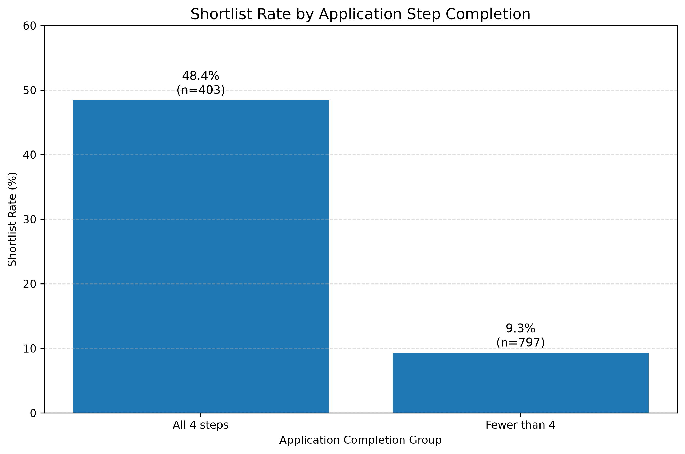

# Student Job Board Analysis

A Python-based data analysis project that examines student job applications to identify recruitment source performance, application completion patterns, and employer response-time differences between paid and unpaid opportunities.

## Project Overview

This project analyzes student job application data collected between July and September 2026. It uses data cleaning, exploratory analysis, statistical summaries, and visualization to identify useful recruitment insights.

The goal is to understand which recruitment channels generate better hiring outcomes, whether application completion is associated with shortlisting, and how employer response times differ between paid and unpaid opportunities.

## Project Objectives

- Analyze hiring performance across recruitment sources.
- Identify the best-performing recruitment sources for different job categories.
- Compare shortlisting rates based on application step completion.
- Compare employer response times for paid and unpaid opportunities.
- Present findings through charts and business recommendations.

## Dataset Description

| Description | Count |
|---|---:|
| Original applications | 1,206 |
| Duplicate application IDs removed | 6 |
| Cleaned applications | 1,200 |
| Dataset columns | 11 |

**Data period:** July–September 2026

The dataset includes application details such as job role, work mode, stipend, recruitment source, application completion, shortlisting, hiring status, and employer response time.

## Technologies Used

- **Python** – Data analysis and processing
- **Pandas** – Data cleaning and manipulation
- **NumPy** – Numerical operations
- **Matplotlib** – Data visualization

## Project Workflow

1. **Data Inspection:** Examined dataset structure, column types, missing values, and duplicate records.
2. **Data Cleaning:** Removed duplicate application IDs, handled missing recruitment sources, and standardized relevant values.
3. **Source Analysis:** Compared application volume and hiring rates across recruitment channels.
4. **Role-Wise Analysis:** Evaluated recruitment source performance for different job categories.
5. **Application Completion Analysis:** Compared shortlisting rates for completed and incomplete applications.
6. **Paid vs Unpaid Analysis:** Compared employer response times and applications without recorded reply times.
7. **Visualization:** Created charts to communicate important findings.

## Key Findings

### 1. Recruitment Source Performance

| Recruitment Source | Applications | Hires | Hires per 100 Applications |
|---|---:|---:|---:|
| Referral | 121 | 13 | 10.74 |
| Email | 160 | 13 | 8.13 |
| Search | 439 | 25 | 5.69 |
| College | 208 | 7 | 3.37 |
| Social | 257 | 6 | 2.33 |
| Unknown | 15 | 0 | 0.00 |

**Insight:** Referral achieved the highest hiring rate, while Search generated the highest total number of hires.

### 2. Role-Wise Recruitment Source Performance

| Job Category | Best Observed Source | Applications | Hires per 100 Applications |
|---|---|---:|---:|
| Data | Search | 81 | 7.41 |
| Design | Referral | 13 | 23.08 |
| Finance | Search | 34 | 2.94 |
| Marketing | Referral | 18 | 22.22 |
| Operations | College | 15 | 20.00 |
| Software | Email | 44 | 11.36 |

**Insight:** Recruitment source performance varied across job categories. A role-specific recruitment strategy may be more useful than relying on a single source.

### 3. Application Completion and Shortlisting

| Application Completion | Applications | Shortlisted | Shortlisting Rate |
|---|---:|---:|---:|
| All 4 steps completed | 403 | 195 | 48.39% |
| Fewer than 4 steps | 797 | 74 | 9.28% |

**Insight:** Applications completing all four steps had a substantially higher observed shortlisting rate.

### 4. Paid vs Unpaid Employer Response Analysis

| Metric | Paid Opportunities | Unpaid Opportunities |
|---|---:|---:|
| Total applications | 734 | 466 |
| Average response time | 3.22 days | 7.63 days |
| Median response time | 3 days | 7 days |
| No recorded reply time | 96 (13.08%) | 138 (29.61%) |

**Insight:** Paid opportunities had faster recorded response times and a lower proportion of applications without a recorded reply time.

## Data Visualization

The following chart compares shortlisting rates based on application completion.




## Business Insights

### 1. Referral Sources Show Strong Hiring Performance
- Referral applications achieved the highest hiring rate at 10.74 hires per 100 applications.
- Search generated the highest total number of hires (25).
- **Business implication:** Employers can use search platforms for application volume while exploring referral programs to improve hiring efficiency.

### 2. Application Completion Is Associated with Higher Shortlisting
- Applications completing all four steps had a 48.39% shortlisting rate.
- Applications completing fewer than four steps had a 9.28% shortlisting rate.
- **Business implication:** Employers should simplify application instructions and monitor where candidates drop out.

### 3. Paid Opportunities Had Faster Recorded Response Times
- Paid opportunities had an average recorded response time of 3.22 days.
- Unpaid opportunities had an average recorded response time of 7.63 days.
- **Business implication:** Employers should monitor response times and improve communication with applicants.

### 4. Unpaid Opportunities Had More Missing Response Records
- 13.08% of paid applications had no recorded reply time.
- 29.61% of unpaid applications had no recorded reply time.
- **Business implication:** Employers should maintain consistent application tracking and update candidates about their application status.

*Note: These findings describe patterns in the available dataset. They do not establish cause-and-effect relationships.*


## Business Recommendations

1. Strengthen referral and email recruitment channels.
2. Select recruitment channels according to job category.
3. Encourage applicants to complete all required application steps.
4. Introduce reminders for incomplete applications.
5. Encourage employers to provide timely application updates.
6. Monitor hiring rates and response-time trends regularly.

## Project Structure

```text
StudentJobBoardAnalysis/
│
├── main.py
├── data_inspection.py
├── data_cleaning.py
├── source_analysis.py
├── role_source_analysis.py
├── step_completion_analysis.py
├── paid_unpaid_analysis.py
├── create_chart.py
│
├── job-board-applications.csv
├── cleaned_applications.csv
├── source_analysis.csv
├── role_source_analysis.csv
├── best_source_by_role.csv
├── step_completion_analysis.csv
├── paid_unpaid_analysis.csv
│
├── shortlist_rate_by_steps.png
├── manager_note.txt
├── requirements.txt
└── README.md
```

## Installation and Execution

### 1. Clone the repository

```powershell
git clone https://github.com/mahakal45x09/StudentJobBoardAnalysis.git
cd StudentJobBoardAnalysis
```

### 2. Create a virtual environment

```powershell
python -m venv venv
```

### 3. Activate the virtual environment

```powershell
.\venv\Scripts\Activate.ps1
```

### 4. Install dependencies

```powershell
python -m pip install -r requirements.txt
```

### 5. Run the analysis scripts

Execute the scripts in the following order:

```powershell
python data_inspection.py
python data_cleaning.py
python source_analysis.py
python role_source_analysis.py
python step_completion_analysis.py
python paid_unpaid_analysis.py
python create_chart.py
```

The scripts generate cleaned datasets, analysis CSV files, and a visualization.

## Conclusion

This project demonstrates how Python-based data analysis can turn raw student job application data into meaningful recruitment insights.

It highlights differences in recruitment source performance, application completion patterns, and employer response times. The findings can support better recruitment planning and application-process improvements.

## Data Limitations

- The analysis is based on the available student job application dataset.
- Missing response-time values indicate no recorded reply time, not confirmed cases where employers never responded.
- Some role-source combinations have relatively small application counts.
- Observed relationships do not establish causation.
- Results show patterns in this dataset and should not be treated as guaranteed cause-and-effect relationships.

---

**Project:** Student Job Board Analysis
**Tools:** Python | Pandas | NumPy | Matplotlib
